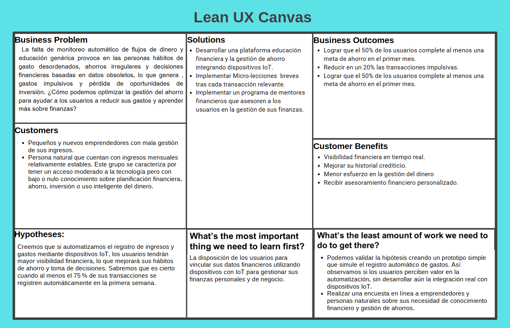

# Capítulo I: Introducción

[Volver al informe](../README.md) · Fuente: páginas físicas 8–21 del PDF.

Se conserva el desarrollo del primer hito, que coincide con esta parte del PDF. Las capacidades de IA, IoT, metas y alertas descritas son la visión del producto; el alcance implementado se detalla en el capítulo V.

## 1.1. Startup Profile

### 1.1.1. Descripción de la startup

FinanZen es una startup desarrollada por un equipo de trabajo conformado por alumnos de Ingeniería de Sistemas de Información e Ingeniería de Software de la Universidad Peruana de Ciencias Aplicadas, que tiene como objetivo transformar la vida financiera de las personas en todo el mundo.

Con la ayuda de tecnologías como el Internet de las Cosas (IoT), que permite conectar y transferir datos entre objetos y dispositivos, y la inteligencia artificial predictiva, los usuarios podrán registrar sus ingresos, gastos y productos adquiridos en su día a día.

Además, podrán crear planes financieros personalizados, diseñados de manera inteligente gracias a la inteligencia artificial generativa. Estos planes incluirán metas de ahorro, proyecciones de compras inteligentes, visualización de precios de productos recurrentes en tiempo real y acceso a tasas de cambio actualizadas.

## 1.2. Solution Profile

Nuestra aplicación móvil FinanZen resuelve problemas de adultos y emprendedores jóvenes que comienzan a desenvolverse en el mundo financiero, como el manejo de sus gastos y planes de ahorro con buenos resultados. Esto es útil sobre todo en la adultez, cuando una persona tiene que conocer los diferentes procesos y beneficios que se obtienen al saber administrar correctamente su dinero.

Además, en la actualidad del Perú, muchas personas no están informadas acerca de cómo manejar sus ingresos y gastos de una manera óptima. De esta forma, los usuarios de nuestra startup podrán visualizar y organizar sus gastos e ingresos, sus resultados en función del tiempo y las compras que realizaron. También serán capaces de registrar transacciones en tiempo real y recibirán notificaciones sobre consumos excesivos cuando sea necesario.

Para brindar más posibilidades de uso, la aplicación tendrá compatibilidad con otros dispositivos IoT como relojes, automóviles, celulares y herramientas de tipo *smart home*, como medidores inteligentes de electricidad y agua. De esta manera, cualquier ciudadano podrá visualizar las entradas y salidas de su dinero.

### 1.2.1. Antecedentes y problemática (5W y 2H)

#### What

##### ¿Cuál es el problema?

El problema principal que observamos es el poco conocimiento que tienen los ciudadanos peruanos acerca de las finanzas y, por ende, el mal manejo que hacen de ellas. En el Perú se brinda una pobre educación financiera a los jóvenes al momento de culminar los estudios secundarios.

Al terminar el colegio comienza el camino hacia la etapa adulta y uno de los temas más importantes es el manejo del dinero. Sin embargo, muchas personas no están informadas respecto al manejo de los ingresos y gastos que registran en su día a día. Esto puede perjudicar a largo plazo tanto a quienes obtienen ingresos por un trabajo como a quienes han comenzado un emprendimiento con deudas. En todos los casos, estos problemas pueden causar inestabilidad económica.

##### ¿Cuál es la relación con la persona en cuestión?

El problema tiene una raíz económica que afecta directamente a los usuarios a los que queremos ayudar. Muchos de ellos, al no contar con conocimientos sobre cómo administrar su dinero, suelen desarrollar malos hábitos financieros, como el gasto excesivo, la falta de sostenibilidad y la ausencia de proyección a futuro.

Esta situación es preocupante, ya que en el Perú se ha dado poca importancia a la educación financiera, especialmente entre los jóvenes. Por eso, no solo les mostraremos su plan financiero de manera clara, sino que también les enseñaremos paso a paso los procesos seguidos para que puedan aprender a desenvolverse por sí mismos. De esta forma, ayudaremos tanto a trabajadores como a jóvenes emprendedores a planificar su panorama financiero con estrategias claras y mediante una plataforma rápida, intuitiva y eficaz.

#### Why

##### ¿Por qué existe este problema?

La existencia de este problema se debe a la escasa preparación financiera que se brinda en escuelas y universidades, así como al poco tiempo e interés que muchas personas dedican a aprender a manejar sus finanzas.

Esta situación puede originarse, en parte, por una idea errónea común: “Manejar tu dinero es intuitivo; solo hay que ganar más y gastar menos”. Sin embargo, la realidad es mucho más compleja, ya que cada persona tiene necesidades y oportunidades distintas. Por lo tanto, este problema persiste debido a la falta de educación financiera y al desinterés general en adquirir hábitos adecuados de manejo económico.

##### ¿Por qué es importante resolverlo?

Es importante resolver este problema porque el potencial de una persona puede verse limitado por su situación económica. Un buen manejo de las finanzas personales permite a los individuos avanzar con mayor libertad, estabilidad y satisfacción en sus vidas.

La educación financiera no solo mejora su bienestar material, sino también su capacidad de tomar decisiones con confianza y proyectarse hacia un futuro más seguro. Brindarles herramientas adecuadas les permitirá tener una visión más clara de cómo alcanzar sus metas y lograr el éxito de manera sostenible.

#### When

##### ¿Cuándo sucede el problema?

El problema de la escasa educación financiera en el Perú se manifiesta cuando la baja inversión del Estado en este tipo de enseñanza dentro de las escuelas, tanto públicas como privadas, afecta a miles de jóvenes que terminan sus estudios sin una orientación económica adecuada. Esto los lleva a enfrentar la vida adulta sin las herramientas necesarias para tomar decisiones financieras responsables y sostenibles.

##### ¿Cuándo utiliza el cliente el producto?

El usuario podrá utilizar diariamente la plataforma móvil cuando lo desee para planificar su panorama financiero y llevar un control detallado de cada movimiento económico que realice durante el día, desde cualquier dispositivo inteligente.

#### Where

##### ¿Dónde está el cliente cuando usa el producto?

El cliente utiliza la aplicación principalmente en entornos donde puede concentrarse y reflexionar sobre sus finanzas personales, como su hogar, una biblioteca, una oficina personal o incluso una cafetería tranquila.

Dado que la plataforma está diseñada para ser totalmente accesible desde dispositivos móviles, también puede utilizarla en movimiento: durante un trayecto en transporte público, mientras espera una reunión o en cualquier momento libre del día. La única condición es contar con un smartphone, tablet o laptop con conexión a Internet. Esta flexibilidad permite que el usuario incorpore la planificación financiera como parte de su rutina diaria, sin depender de un espacio físico fijo ni de horarios específicos.

##### ¿A dónde se dirige?

Nuestro servicio está dirigido principalmente a adultos jóvenes y emprendedores que desean adquirir herramientas prácticas para manejar su dinero de forma eficiente. Buscamos acompañarlos en su camino hacia la estabilidad financiera, brindándoles estrategias claras y personalizadas que les permitan organizar sus ingresos, controlar sus gastos y proyectar un futuro económico más seguro.

##### ¿Dónde surge el problema?

El problema surge en la etapa en la que nuestros usuarios comienzan a generar ingresos propios, ya sea al iniciar su primer empleo o al emprender un negocio. En ese momento crucial, muchos no cuentan con la orientación ni el conocimiento necesario sobre cómo planificar su dinero, lo que los lleva a cometer errores financieros por falta de información o por creer que el manejo del dinero es intuitivo.

#### Who

##### ¿Quiénes están involucrados?

Están involucradas todas aquellas personas que comienzan a desenvolverse en el mundo laboral, así como los ingresos que generan a partir de sus actividades económicas. Este grupo incluye a jóvenes profesionales, técnicos, *freelancers* y emprendedores que empiezan a tomar decisiones financieras por cuenta propia.

##### ¿A quiénes les sucede el problema?

El problema afecta principalmente a adultos jóvenes que acaban de alcanzar la mayoría de edad y a emprendedores que están dando sus primeros pasos en el mercado. Al no contar con una base sólida de educación financiera, suelen enfrentar dificultades para organizar su dinero, proyectar gastos o tomar decisiones estratégicas con sus ingresos.

##### ¿Quiénes lo utilizarán?

La plataforma será utilizada por trabajadores y emprendedores jóvenes que desean aprender a administrar correctamente su dinero. Buscan una herramienta práctica, accesible y didáctica que los ayude a tomar el control de sus finanzas personales desde etapas tempranas de su vida económica.

#### How

##### ¿Cómo ocurre el problema?

El problema ocurre cuando nuestros usuarios ingresan al mundo laboral y reciben su primer sueldo, pero no cuentan con los conocimientos necesarios para administrarlo correctamente. Esto los lleva a tomar decisiones impulsivas o desorganizadas con su dinero, generando estrés, descontrol financiero y falta de visión a mediano plazo.

##### ¿En qué condiciones los clientes usan nuestro producto?

Los clientes utilizan FinanZen desde la comodidad de sus hogares o en cualquier otro lugar donde se encuentren, gracias a que la aplicación opera en tiempo real y notifica cada movimiento de dinero. Suelen usarla como parte de su rutina diaria, especialmente al inicio de mes para planificar sus finanzas o al realizar gastos importantes durante el día.

##### ¿Cómo nos conocieron los compradores?

Los usuarios conocen FinanZen principalmente a través de campañas publicitarias digitales, redes sociales y recomendaciones de comunidades juveniles interesadas en mejorar su vida financiera.

##### ¿Cómo prefieren los lectores acceder a nuestro contenido?

La mayoría de los usuarios prefiere acceder a FinanZen mediante su smartphone por la comodidad y rapidez que ofrece. También pueden hacerlo desde otros dispositivos inteligentes como relojes inteligentes (*smartwatches*), tablets o incluso televisores, según su estilo de vida.

##### ¿Qué llevó a la persona a llegar a esta situación?

Generalmente, el usuario llega a nuestra solución impulsado por la preocupación de no poder cubrir sus gastos personales o responsabilidades financieras a fin de mes. La necesidad de organizar mejor su dinero y tener una visión clara de su economía es lo que lo motiva a buscar herramientas como FinanZen.

#### How much

En la actualidad, muchos jóvenes peruanos que alcanzan la mayoría de edad ingresan al mundo laboral con el objetivo de cubrir sus gastos personales o contribuir a la economía familiar y educativa. Esta etapa de transición suele estar marcada por ingresos limitados y compromisos financieros crecientes.

En muchos casos, recurren a préstamos bancarios para cubrir deudas o mantener sus estudios, lo cual agrava aún más su situación económica. Un ejemplo claro son los estudiantes universitarios, quienes trabajan para costear su educación, transporte y alimentación diaria. Esto refleja la necesidad urgente de herramientas accesibles que les permitan optimizar sus recursos, evitar el sobreendeudamiento y tener un mayor control de su economía personal desde el inicio de su vida financiera.

### 1.2.2. Lean UX Process

#### Lean UX Problem Statement

Hemos notado que muchas personas naturales y pequeños emprendedores tienen dificultades para organizar sus finanzas y mantener un ahorro constante. Esto se debe, en gran parte, a que no cuentan con herramientas que les permitan monitorear automáticamente sus ingresos, gastos y hábitos de consumo. Además, la información financiera que encuentran suele ser genérica o poco aplicable a su día a día.

Como resultado, terminan tomando decisiones con información incompleta o desactualizada, lo que los lleva a gastar de forma impulsiva, ahorrar sin consistencia y perder oportunidades de inversión o crecimiento económico. No tienen algo o alguien que los ayude a hacer que la gestión de su dinero sea más clara, automatizada y educativa. Por ello, les interesará recibir recomendaciones personalizadas y microlecciones financieras que realmente se adapten a su contexto.

#### Lean UX Assumptions

##### ¿Quién es el usuario?

Creemos que nuestros usuarios son personas naturales con poca disciplina de ahorro y pequeños o nuevos emprendedores que manejan ingresos variables. Estas personas están interesadas en mejorar su control financiero y desean aprender conceptos básicos de finanzas de forma práctica y accesible.

##### ¿Dónde encaja nuestro producto en su trabajo o vida?

Asumimos que nuestra aplicación se integrará en su día a día como la plataforma principal para:

- Registrar ingresos y gastos al momento en que ocurren, automáticamente o de forma manual.
- Recibir recomendaciones de ahorro y microlecciones justo cuando estén por hacer una compra o pago.
- Revisar sus avances en metas de ahorro al iniciar el día o al final de la jornada.

##### ¿Qué problemas resuelve nuestro producto?

El producto resolverá problemas relacionados con:

- Registrar y gestionar gastos sin fricción.
- Tomar decisiones con información actualizada, evitando errores por desinformación.
- Transformar hábitos de consumo impulsivo en conductas de ahorro sistemático y sostenido.

##### ¿Cuándo y cómo es usado nuestro producto?

Creemos que los usuarios interactuarán con la aplicación varias veces al día, especialmente:

- Al hacer pagos con efectivo o tarjeta, momento en el que recibirán notificaciones.
- Al revisar resúmenes de gastos durante el día.
- Al planificar el mes, estableciendo metas de ahorro y revisando patrones históricos.

##### ¿Qué características valoran más?

Asumimos que valorarán especialmente:

- La sincronización automática mediante IoT, como cuentas bancarias, cajas de venta o pulseras de detección de movimiento.
- La posibilidad de definir metas de ahorro personalizadas con recordatorios automáticos.
- Una interfaz intuitiva y cómoda que no requiera conocimientos técnicos.

##### ¿Cómo debe verse nuestro producto y cómo debe comportarse?

Pensamos que el producto debe tener una estética limpia y moderna, con una interfaz amigable tanto en dispositivos móviles como en la web. Además, debe:

- Ser fácil de navegar, sin curvas de aprendizaje.
- Mantener patrones de navegación consistentes entre plataformas.
- Responder de forma rápida, con tiempos de carga mínimos.

#### Lean UX Hypothesis Statements

##### Hipótesis 1: Registro automático con IoT

Creemos que los usuarios con dificultad para hacer seguimiento a sus finanzas necesitan una forma precisa y automática de registrar sus ingresos y gastos.

Si les proporcionamos una funcionalidad que integre dispositivos IoT para capturar estos datos en tiempo real, entonces podrán tener una mejor visibilidad y reaccionar de forma oportuna a su situación financiera.

Sabremos que tuvimos éxito cuando al menos el 75 % de todas las transacciones se registren automáticamente durante las primeras dos semanas de uso.

##### Hipótesis 2: Notificaciones anticipadas para evitar excesos

Creemos que los usuarios tienden a gastar más de lo planeado por falta de alertas a tiempo.

Si les enviamos notificaciones anticipadas cuando estén por exceder su presupuesto, entonces podrán ejercer mayor control y reducir sus gastos impulsivos.

Sabremos que tuvimos éxito cuando las transacciones clasificadas como “no planificadas” disminuyan en un 20 % durante el mes siguiente a la activación de las alertas.

##### Hipótesis 3: Metas de ahorro personalizadas

Creemos que los usuarios desean ahorrar, pero les cuesta mantener la constancia sin objetivos definidos.

Si les permitimos crear metas de ahorro con plazos definidos y recordatorios automáticos, entonces podrán generar hábitos más consistentes y cumplir sus objetivos financieros a corto y largo plazo.

Sabremos que tuvimos éxito cuando al menos el 50 % de los usuarios logre alcanzar una meta de ahorro dentro del primer mes de uso.

#### Lean UX Canvas

El canvas se conserva como figura del PDF actualizado (página física 20).

## 1.3. Segmentos objetivo

### 1.3.1. Individuos sin conocimiento financiero

Personas naturales entre 18 y 30 años, residentes de Lima Metropolitana, que cuentan con ingresos mensuales relativamente estables, como empleo formal, trabajo *freelance* continuo o un ingreso fijo.

Este grupo se caracteriza por tener un acceso moderado a la tecnología —smartphones y aplicaciones bancarias—, pero bajo o nulo conocimiento sobre planificación financiera, ahorro, inversión o uso inteligente del dinero.

### 1.3.2. Pequeños o nuevos emprendedores

Pequeños emprendedores o personas que están empezando un negocio propio, formal o informal, con edades entre 25 y 45 años, principalmente en zonas urbanas o semiurbanas.

Muchos de ellos trabajan en sectores como comercio, servicios personales o ventas en línea. A pesar de tener iniciativa y motivación, carecen de conocimientos estructurados sobre finanzas empresariales.
