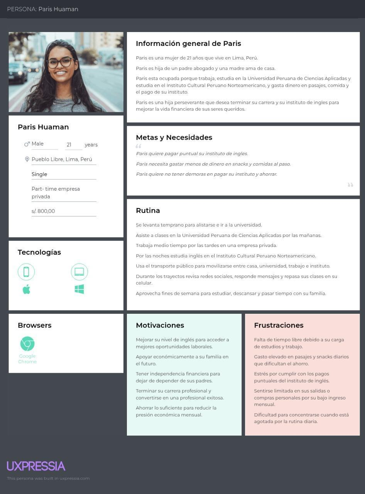
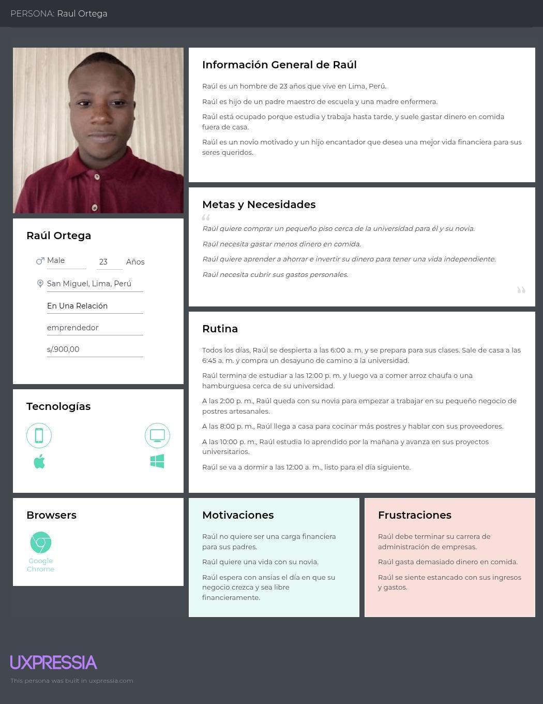
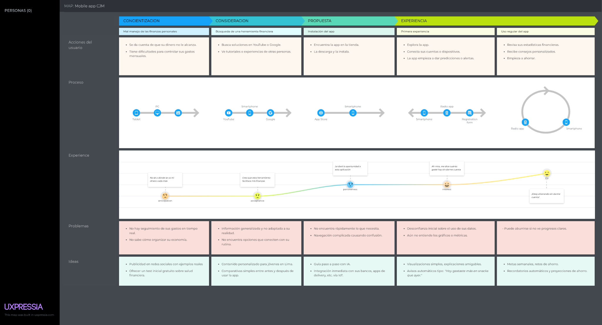
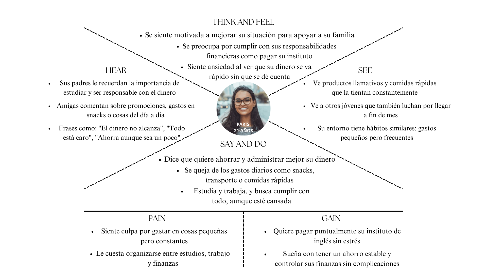
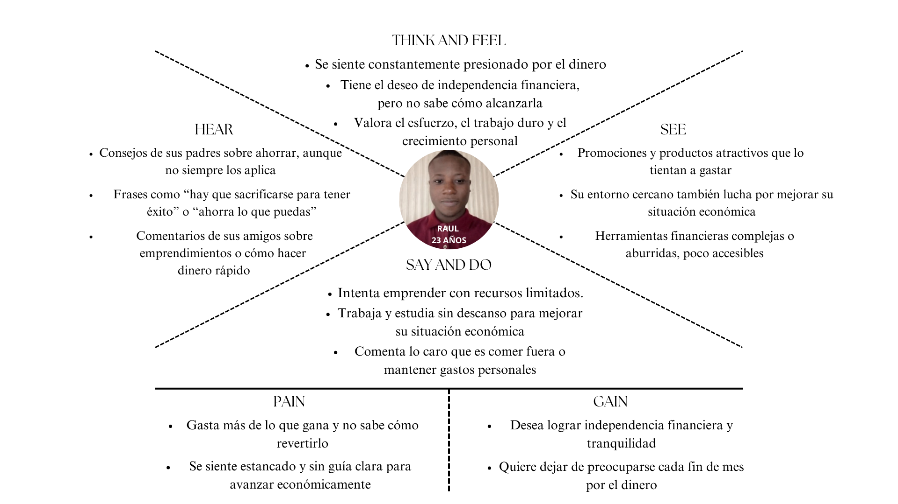

# Capítulo II: Requirements Elicitation & Analysis

[Volver al informe](../README.md) · Fuente: páginas físicas 22–45 del PDF.

Se conserva el análisis competitivo y el diseño de entrevistas del primer hito. Los precios y características de competidores corresponden al documento de investigación; no representan una verificación comercial actual.

## 2.1. Competidores

### 2.1.1. Análisis competitivo

#### Competidores directos

- **Fintonic:** aplicación móvil de finanzas personales que consolida automáticamente todas las cuentas y tarjetas del usuario en un único flujo categorizado y envía alertas ante cargos inesperados.
- **Toshl Finance:** herramienta multiplataforma, móvil y web, para registrar ingresos y gastos manualmente o mediante conexión bancaria y gestionar presupuestos por categoría.
- **Monefy:** aplicación sencilla para añadir ingresos y gastos en pocos pasos. No requiere vincular cuentas; permite crear categorías personalizables, visualizar el presupuesto en un gráfico circular y sincronizar datos opcionalmente entre dispositivos.

#### Competitive Analysis Landscape

El análisis busca contrastar el modelo de negocio de FinanZen con la competencia actual para identificar aciertos, errores y oportunidades de diferenciación.

##### Perfil general

| Competidor | Descripción |
| --- | --- |
| **FinanZen** | Plataforma que combina IoT para capturar automáticamente flujos financieros en tiempo real, microlecciones contextuales de educación financiera, metas de ahorro gamificadas y alertas proactivas para prevenir gastos impulsivos y maximizar oportunidades de inversión. |
| **Fintonic** | Aplicación móvil que consolida cuentas bancarias y tarjetas, categoriza automáticamente los movimientos y envía alertas ante cobros inesperados. |
| **Toshl Finance** | Herramienta móvil y web que permite vincular tarjetas, cuentas bancarias y efectivo, o registrar gastos manualmente. |
| **Monefy** | Aplicación sencilla para registrar ingresos y gastos. |

##### Ventaja competitiva

| Competidor | Valor ofrecido |
| --- | --- |
| **FinanZen** | Amplio catálogo de funciones para gestionar el dinero con inteligencia artificial predictiva y posibilidad de conectar más de un dispositivo inteligente. |
| **Fintonic** | Consolidación automática de cuentas y tarjetas en un único flujo categorizado, sin ingresar individualmente a cada banco. |
| **Toshl Finance** | Presupuestos por categoría con gráficos interactivos y reportes que muestran a dónde va el dinero. |
| **Monefy** | Sincronización opcional y segura entre dispositivos. |

##### Perfil de marketing

| Competidor | Mercado objetivo | Estrategia de marketing |
| --- | --- | --- |
| **FinanZen** | Personas naturales y pequeños o nuevos emprendedores. | Publicidad en lugares comerciales y redes sociales. |
| **Fintonic** | Consumidores con ingresos estables, entre 25 y 45 años. | Marketing de contenidos en blogs y redes sociales, destacando casos de ahorro y finanzas personales. |
| **Toshl Finance** | Jóvenes adultos, entre 18 y 35 años. | Fuerte presencia en blog propio y redes sociales. |
| **Monefy** | Estudiantes, *freelancers* y usuarios que valoran la privacidad y facilidad de uso. | Posicionamiento en comparativas de medios especializados. |

##### Perfil de producto

| Competidor | Productos y servicios |
| --- | --- |
| **FinanZen** | Aplicación web y móvil con microlecciones contextuales después de cada transacción, establecimiento y seguimiento gamificado de metas de ahorro y alertas proactivas basadas en hábitos. |
| **Fintonic** | Agregación automática de cuentas y tarjetas bancarias, categorización inteligente de movimientos y alertas ante comisiones o cargos inesperados. |
| **Toshl Finance** | Registro manual de gastos e ingresos o mediante conexión bancaria, presupuestos por categoría, soporte multidivisa y gráficos interactivos. |
| **Monefy** | Seguimiento rápido de ingresos y gastos, categorías personalizables, soporte multidivisa y sincronización opcional mediante Google Drive o Dropbox. |

##### Precios, costos y distribución

| Competidor | Precio | Canales de distribución |
| --- | --- | --- |
| **FinanZen** | Versión demo gratuita y planes de S/ 15, S/ 30, S/ 50 y S/ 100. | Web y aplicación móvil para Android e iOS. |
| **Fintonic** | Aplicación gratuita. | Web y aplicación móvil. |
| **Toshl Finance** | Plan Pro de S/ 11.15 mensuales. | Web y aplicación móvil. |
| **Monefy** | Versión gratuita con publicidad y funciones básicas. Plan Pro de S/ 6.06 mensuales. | Web y aplicación móvil. |

##### Análisis SWOT

| Competidor | Fortalezas | Debilidades | Oportunidades | Amenazas |
| --- | --- | --- | --- | --- |
| **FinanZen** | Decisiones basadas en datos recopilados; prevención de riesgos financieros; sugerencias de decisiones financieras; predicciones económicas. | Desconfianza en la tecnología IoT. | Expansión a nuevos mercados de Latinoamérica y Europa. | Reticencia de los usuarios a instalar sensores y costos asociados. |
| **Fintonic** | Alertas proactivas ante comisiones, recibos duplicados o descubiertos. | El modelo *freemium* basado en comisiones de productos puede reducir la conversión de usuarios que no desean contratar servicios financieros. | Explorar IoT para automatizar aún más el registro de gastos. | Riesgos de ciberseguridad y fuga de datos sensibles. |
| **Toshl Finance** | Presupuestos por categoría y gráficos interactivos fáciles de interpretar. | La conexión bancaria tiene un costo adicional que puede frenar a usuarios sensibles al precio. | Incorporar análisis de hábitos de gasto basados en IA. | Saturación del mercado de finanzas personales con ofertas *freemium* agresivas. |
| **Monefy** | Facilidad y rapidez de uso. | No dispone de versión web nativa, lo que limita el acceso desde computadoras. | No especificada en el documento. | Migración de usuarios hacia aplicaciones con conectividad bancaria y más funciones. |

El cuadro comparativo muestra que FinanZen destaca frente a sus competidores porque combina registro automático mediante IoT, inteligencia artificial para recomendaciones y educación financiera integrada. Esto busca convertirla en una solución más completa e innovadora.

A diferencia de aplicaciones como Fintonic, Toshl Finance o Monefy, enfocadas en el registro manual o en funciones básicas, FinanZen busca automatizar procesos, enseñar y guiar al usuario según su comportamiento financiero. Además, su interfaz moderna, la personalización de metas y el enfoque en jóvenes y emprendedores refuerzan su valor diferencial en un mercado que suele dejar de lado a este segmento.

### 2.1.2. Estrategias y tácticas frente a competidores

#### Estrategia 1: Diferenciación tecnológica mediante automatización e inteligencia artificial

FinanZen busca destacarse mediante la integración de tecnologías emergentes que sus competidores todavía no aplican de forma efectiva.

- **Táctica 1:** implementar el registro automático de gastos mediante dispositivos IoT conectados para reducir la intervención manual del usuario.
- **Táctica 2:** utilizar inteligencia artificial para generar recomendaciones financieras personalizadas, adaptadas al comportamiento y perfil del usuario.

#### Estrategia 2: Educación financiera práctica y contextual

FinanZen se enfoca en un segmento poco atendido: jóvenes y emprendedores que requieren orientación para manejar sus finanzas.

- **Táctica 1:** incluir microcontenidos educativos dentro de la aplicación, activados según las acciones del usuario, por ejemplo, al registrar un gasto o establecer una meta.
- **Táctica 2:** diseñar una interfaz amigable con rutas guiadas que faciliten el aprendizaje sin requerir conocimientos financieros previos.

## 2.2. Entrevistas

### 2.2.1. Diseño de entrevistas

Las entrevistas se realizarán a dos tipos de personas: individuos sin conocimiento financiero y pequeños o nuevos emprendedores. Para cada segmento se propone el siguiente conjunto de preguntas.

#### Segmento 1: Individuos sin conocimiento financiero (18 a 30 años)

##### A. Conocimiento y percepción del dinero

- ¿Cómo manejas actualmente tus ingresos mensuales? ¿Tienes algún sistema o método?
- ¿Alguna vez has intentado ahorrar o planificar tus gastos? ¿Cómo te fue?
- ¿Qué significa para ti “tener una buena salud financiera”?

##### B. Uso de tecnología

- ¿Qué tipo de aplicaciones relacionadas con dinero utilizas actualmente, como banca, pagos o presupuestos?
- ¿Conoces o has oído hablar del Internet de las Cosas (IoT) o de la inteligencia artificial (IA)? ¿Qué opinas de estas tecnologías?
- ¿Qué tan cómodo te sentirías si una aplicación o dispositivo te sugiriera cómo manejar tu dinero?

##### C. Dolores y oportunidades

- ¿Qué dificultades tienes al intentar ahorrar o controlar tus gastos?
- Si una aplicación pudiera ayudarte a prever tus gastos o recomendarte cuánto ahorrar, ¿la usarías? ¿Qué tendría que ofrecer para que confíes en ella?
- ¿Te interesaría recibir alertas o recordatorios basados en tus hábitos de consumo?

##### D. Hábitos y estilo de vida

- ¿En qué sueles gastar más? ¿Te ha sorprendido saber cuánto gastas en ciertas cosas?
- ¿Has sentido que el dinero no te rinde o que se “va” sin saber cómo?

#### Segmento 2: Pequeños o nuevos emprendedores (25 a 45 años)

##### A. Manejo financiero del negocio

- ¿Cómo llevas actualmente el control de los ingresos y egresos de tu negocio?
- ¿Tienes alguna herramienta o método para registrar tus ventas y gastos?
- ¿Cómo decides cuánto reinvertir o cuánto ahorrar de tus ganancias?

##### B. Tecnología y automatización

- ¿Utilizas tecnología, como aplicaciones, dispositivos o software, para manejar tu negocio? ¿Cuál o cuáles?
- ¿Qué opinas de usar herramientas que te den predicciones sobre tus ventas o te sugieran decisiones financieras?
- ¿Conoces qué son la inteligencia artificial y el IoT? ¿Te gustaría que tu negocio se beneficiara de estas tecnologías?

##### C. Retos y necesidades

- ¿Cuál dirías que es tu mayor reto financiero como emprendedor?
- ¿Te ha pasado que no sabes cuánto ganas o pierdes exactamente en un mes?
- Si existiera una herramienta que te diera alertas sobre oportunidades o riesgos financieros, ¿te interesaría?

##### D. Expectativas y valor agregado

- ¿Qué características debería tener una herramienta tecnológica para que la usaras diariamente en tu negocio?
- ¿Confiarías en una aplicación que conecte dispositivos IoT con inteligencia artificial para ayudarte a gestionar tus finanzas?

### 2.2.2. Registro de entrevistas

El PDF incorpora siete registros. Los enlaces y duraciones se transcriben como
evidencia aportada por el documento, sin afirmar una nueva realización o revisión
de las entrevistas.

| Entrevistado | Edad registrada | Duración | Enlace |
| --- | --- | --- | --- |
| Bryan Dorregaray Ubaldo | 19 años | 6:50 | [Entrevista](https://youtu.be/FPu_5LLR4yI) |
| Alejandro Yturregui | 19 años | 4:00 | [Entrevista](https://youtu.be/I_nbSwSdzWU) |
| Sam Puicon | 20 años | 10:00 | [Entrevista](https://www.youtube.com/watch?v=UlK3f9flygM) |
| Lenin Ccana | No indicada | 8:51 | [Entrevista](https://youtu.be/y77XQNts_KU) |
| Almendra Lavi | 20 años | 4:01 | [Entrevista](https://youtu.be/jKs7-JDYk2Q) |
| Andy Mendoza | 20 años | 4:29 | [Entrevista](https://youtu.be/oXGpeXOWKz0) |
| Evelyn Caldas | 45 años | 3:09 | [Entrevista](https://youtu.be/DgZTlnL7f0E) |

### 2.2.3. Análisis de entrevistas

| Registro | Hallazgo documentado | Necesidad identificada |
| --- | --- | --- |
| Bryan | Destina ingresos a alquiler, servicios y transporte; los gastos espontáneos interrumpen el ahorro. | Registro detallado, interfaz accesible y recordatorios. |
| Alejandro | Le cuesta priorizar compras y ahorrar; está abierto a tecnología intuitiva. | Planificación, priorización y educación financiera básica. |
| Sam | Su emprendimiento gastronómico carece de control organizado y presenta balances negativos. | Herramienta personalizable para registrar ingresos y egresos. |
| Lenin | Usa Excel, reinvierte y ahorra aproximadamente 5 %; prefiere evaluar una demo antes de confiar en automatización. | Márgenes claros, alertas de riesgo y transparencia. |
| Almendra | Usa banca móvil y billeteras; comida y delivery acumulan gastos difíciles de percibir. | Recomendaciones, alertas y una experiencia segura. |
| Andy | Lleva un registro básico y busca mantenerse con ingresos superiores a egresos. | Seguimiento personalizable y recordatorios según hábitos. |
| Evelyn | Gestiona un negocio de belleza con Excel, pero pierde claridad sobre el resultado mensual. | Automatización sencilla y visión consolidada del negocio. |

Los hallazgos justifican priorizar el registro de movimientos y la visualización
del saldo como primer incremento. La necesidad de alertas y educación sigue
vigente, pero esas capacidades no están implementadas en el código incorporado.

## 2.3. Needfinding

### 2.3.1. User Personas

Se conservan las figuras originales: Paris Huaman para el primer segmento y Raúl
Ortega para el segundo. Su contenido describe perfiles de investigación, no
cuentas existentes en la aplicación.

### 2.3.2. User Task Matrix

Matriz del PDF para Paris Huaman:

| Tarea | Frecuencia | Importancia |
| --- | --- | --- |
| Registrar ingresos y gastos | Alta | Alta |
| Ver sugerencias de ahorro | Alta | Alta |
| Aprender conceptos básicos de finanzas | Media | Alta |
| Crear metas de ahorro | A veces | Media |
| Conectar dispositivo IoT | A veces | Alta |
| Simular escenarios de inversión | A veces | Alta |
| Integrar con aplicaciones bancarias | Media | Alta |

### 2.3.3. User Journey Mapping

### 2.3.4. Empathy Mapping

Los enlaces a los recursos originales están en
[enlaces del PDF](../fuentes/enlaces_pdf.md).

### 2.3.5. As-Is Scenario Mapping

| Dimensión | Búsqueda de educación financiera | Evaluación de planes | Inicio del programa |
| --- | --- | --- | --- |
| Doing | Investigar plataformas y planes de ahorro. | Comparar metodologías y definir metas. | Revisar temas y suficiencia del programa. |
| Thinking | Buscar una explicación detallada del manejo del dinero. | Preguntarse si el plan permite comenzar de forma proactiva. | Evaluar si se aprenderá lo necesario para decidir. |
| Feeling | Intriga por encontrar información organizada. | Ansiedad por elegir una opción segura. | Miedo a los resultados del plan. |
