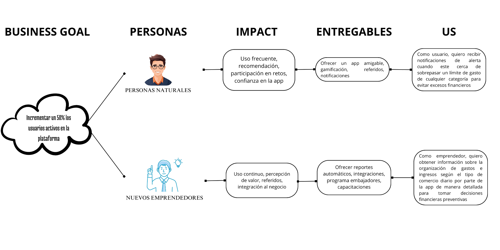
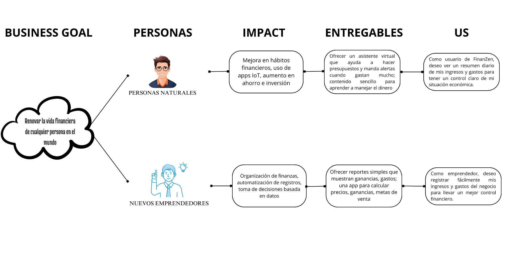

# Capítulo III: Requirements Specification

[Volver al informe](../README.md) · Fuente: páginas físicas 46–59 del PDF.

## 3.1. To-Be Scenario Mapping

| Dimensión | Descubrimiento | Uso y evaluación | Educación financiera activa |
| --- | --- | --- | --- |
| Doing | Ver una recomendación o anuncio, descargar y explorar la aplicación. | Crear cuenta y registrar los primeros ingresos y gastos. | Iniciar un curso personalizado. |
| Thinking | ¿La aplicación ayudará con mis finanzas? | Puedo controlar mejor mi dinero. | Estoy aprendiendo lo que no me enseñaron. |
| Feeling | Curiosidad | Confianza | Alivio y orgullo por el progreso |

El escenario describe la experiencia objetivo; el incremento actual implementa
el registro y el resumen mediante una cuenta de demostración.

## 3.2. User Stories

| Épica | Nombre | Historias |
| --- | --- | --- |
| EP01 | Análisis predictivo de finanzas | US01–US03 |
| EP02 | Curso de educación financiera personalizado | US04–US06 |
| EP03 | Conexión de dispositivos inteligentes | US07–US09 |
| EP04 | Gestión inteligente de ingresos y gastos | US10–US12 |
| EP05 | Presentación del producto y del equipo | US13–US14 |

Las historias y criterios siguientes se transcriben del PDF, normalizando los
espacios. Se conservan sus identificadores. La revisión de inconsistencias y
el estado real de implementación aparecen al final del capítulo.

### US01: Registrar datos financieros

Épica: **EP01**.

Como usuario,quiero registrar el saldo de mis cuentas bancarias para recibir el análisis de mis ingresos y gastos con la ayuda del sistema

**Escenario 1:** Ingreso de datos de manera correcta Dado que el usuario ingreso al apartado de análisis predictivo de finanzas , Cuando el usuario haga click en el botón “Registrar datos para el análisis”, Entonces el sistema deberá mostrar una ventana donde se le pedirá al usuario rellenar sus datos como saldo de cuentas bancarias, Y una vez que el usuario complete sus datos, Entonces el sistema deberá guardar los datos y mostrar un mensaje que dice “Ingreso de datos exitoso”

**Escenario 2:** Error al enviar datos al sistema Dado que el usuario ingreso al apartado de análisis predictivo de finanzas , Cuando el usuario haga click en el botón “Registrar datos para el análisis”, Entonces el sistema deberá mostrar una ventana donde se le pedirá al usuario rellenar sus datos como saldo de cuentas bancarias, Y si el usuario pone caracteres no permitidos o espacios en blanco al momento de rellenar sus datos, Entonces el sistema no podrá guardar los datos y mostrará un mensaje que diga ”Error al registrar los datos,por favor,ingrese los datos correctamente”

### US02: Visualización de proyecciones financieras

Épica: **EP01**.

Como usuario,quiero visualizar las predicciones de mis ingresos y gastos en el final del mes, para determinar con anticipación si podré cubrir todos mis gastos

**Escenario 1:** Observación de proyecciones financieras exitosa Dado que el usuario ingreso al apartado de proyecciones financieras, Y el usuario seleccione la pestaña generar proyección financiera, Cuando el usuario haga click en visualizar proyección financiera, Entonces el sistema mostrará los datos de su proyección financiera como ingresos y gastos para el final de mes

**Escenario 2:** Observación de proyecciones financieras fallida Dado que el usuario ingreso al aparte de proyecciones financieras, Y el usuario seleccione la pestaña generar proyección financiera, Cuando el usuario haga click en visualizar proyección financiera, Y no haya datos suficientes para generar una proyección financiera, Entonces el sistema mostrará un mensaje que diga “No se pudo generar la proyección,no se encontraron los datos suficientes”

### US03: Notificación de alerta ante signos de endeudamiento financiero

Épica: **EP01**.

Como usuario,quiero recibir alertas del sistema que determine posibles patrones que demuestran un riesgo de endeudamiento,para poder tomar medidas preventivas

**Escenario 1:** Notificación de posible endeudamiento exitosa Dado que el usuario ingreso al apartado de análisis de finanzas, E ingresa a la pestaña configuración , Cuando el usuario presione la opción de notificar alertas de endeudamiento, Entonces el sistema le notificará cuando hay riesgo de endeudamiento en el análisis de datos financieros

**Escenario 2:** Dado que el usuario ingresó al apartado de análisis de finanzas, Y accedió a la pestaña de configuración, Cuando intente activar la opción “Notificar alertas de endeudamiento” y ocurra un error del sistema, Entonces el sistema debe mostrar un mensaje: “No se pudo activar la alerta en este momento. Intente más tarde”.

### US04: Evaluación previa de conocimientos en finanzas

Épica: **EP02**.

Como usuario,quiero realizar un cuestionario financiero inicial antes del curso ,para que la aplicación determine mi nivel financiero y me recomiende el curso adecuado

**Escenario 1:** Recomendación de curso exitosa Dado que el usuario accede al curso de educación financiera por primera vez, Cuando responde todas las preguntas del cuestionario inicial y hace clic en “Enviar respuestas”, Entonces el sistema debe analizar las respuestas, asignar un nivel financiero y mostrar la recomendación de curso adecuada.

**Escenario 2:** Recomendación de curso fallida Dado que el usuario accede al cuestionario inicial, Cuando intenta enviar el formulario sin completar todas las preguntas obligatorias, Entonces el sistema debe mostrar un mensaje de error indicando que debe completar todas las respuestas antes de continuar.

### US05: Recomendación de módulos financieros del curso

Épica: **EP02**.

Como usuario,quiero recibir recomendaciones de secciones del curso según mis hábitos de gasto, para aprender lo que tengo que mejorar en mis finanzas

**Escenario 1:** Recomendación de módulos exitosa Dado que el usuario tiene hábitos de gasto registrados en la app, Cuando accede al curso, Entonces el sistema debe analizar sus hábitos y mostrarle recomendaciones de módulos personalizados para mejorar sus finanzas.

**Escenario 2:** No hay datos de gasto registrados Dado que el usuario accede al curso sin haber registrado datos financieros, Cuando el sistema intente generar recomendaciones, Entonces debe mostrar un mensaje como: “No se encontraron datos para realizar la recomendación”

### US06: Actualización del contenido de acuerdo al perfil financiero

Épica: **EP02**.

Como usuario,quiero que la app adapte el contenido del curso cada vez que haya cambios en mi perfil financiero, para que el curso siga siendo de utilidad

**Escenario 1:** Actualización del contenido exitoso Dado que el usuario ha completado una parte del curso, Cuando el sistema detecta un cambio en su perfil financiero (por ejemplo, aumento de ingresos), Entonces el contenido del curso se ajusta automáticamente para enfocarse en nuevas prioridades.

**Escenario 2:** Actualización del contenido fallido Dado que el perfil financiero del usuario ha cambiado, Cuando el sistema intenta adaptar el contenido pero falla en la sincronización, Entonces se debe mostrar un mensaje: “No fue posible actualizar el contenido, intente más tarde”.

### US07: Conexión de dispositivos inteligentes a la app

Épica: **EP03**.

Como usuario,quiero conectar diferentes dispositivos inteligentes como smartwatches,altavoces,medidores de energía inteligentes,entre otros a la app, para obtener más alternativas de recolección de datos y permitir que la app me brinde una proyección financiera de acuerdo a mis posibles consumos

**Escenario 1:** Conexión de dispositivo exitoso Dado que el usuario tiene dispositivos inteligentes compatibles, Cuando accede a la opción “Conectar dispositivos” y autoriza el acceso, Entonces el sistema establece la conexión y comienza a recopilar datos.

**Escenario 2:** Conexión de dispositivo fallido Dado que el usuario intenta conectar un dispositivo, Cuando el sistema no lo reconoce, Entonces se debe mostrar un mensaje como: “Este dispositivo no es compatible actualmente”.

### US08: Configuración de alertas de dispositivos inteligentes

Épica: **EP03**.

Como usuario,quiero configurar desde mi celular las alertas financieras asignadas a cada dispositivo inteligente, para obtener una mejor visualización del consumo mensual de cada una y obtener un plan financiero organizado

**Escenario 1:** Configuración de alerta exitoso Dado que el usuario ha conectado varios dispositivos, Cuando accede a la sección de alertas y asigna tipos de notificaciones a cada uno, Entonces el sistema guarda la configuración y envía las alertas según lo establecido.

**Escenario 2:** Configuración de alerta fallido Dado que el usuario configura alertas, Cuando no guarda los cambios, Entonces el sistema debe advertirle: “Debe guardar la configuración antes de salir”.

### US09: Integración de los análisis financieros de los dispositivos inteligentes

Épica: **EP03**.

Como usuario,quiero observar que los datos recopilados de diferentes dispositivos inteligentes se integren en un solo análisis financiero ,para visualizar información detallada de cada consumo asociada a cada uno

**Escenario 1:** Integración de análisis financiero exitoso Dado que el usuario ha conectado varios dispositivos, Cuando accede a la sección de alertas y asigna tipos de notificaciones a cada uno, Entonces el sistema guarda la configuración y envía las alertas según lo establecido.

**Escenario 2:** Integración de análisis financiero fallido Dado que el usuario configura alertas, Cuando no guarda los cambios, Entonces el sistema debe advertirle: “Debe guardar la configuración antes de salir”.

### US10: Recomendacion de presupuesto mensual personalizado

Épica: **EP04**.

Como usuario,quiero recibir una recomendación de presupuesto mensual en base a mis ingresos y hábitos de gasto mensualmente, para gestionar mejor mi dinero

**Escenario 1:** Recomendación de presupuesto mensual exitosa Dado que el usuario tiene ingresos y hábitos de gasto registrados, Cuando inicia el mes, Entonces la app genera una recomendación de presupuesto personalizada.

**Escenario 2:** Recomendación de presupuesto mensual fallida Dado que el usuario no ha registrado datos recientes, Cuando solicita una recomendación de presupuesto, Entonces el sistema muestra: “No hay suficiente información para generar un presupuesto”.

### US11: Notificación de alertas por límites de gasto

Épica: **EP04**.

Como usuario,quiero recibir notificaciones de alerta cuando este cerca de sobrepasar un límite de gasto de cualquier categoría, para evitar excesos financieros

**Escenario 1:** Notificación de alertas exitosa Dado que el usuario establece límites de gasto, Cuando se aproxima a sobrepasar el límite en una categoría, Entonces la app le envía una notificación de alerta.

**Escenario 2:** Notificación de alertas fallida Dado que el usuario establece límites de gasto, Cuando el sistema no logra enviar la notificación, Entonces debe registrar el intento fallido y mostrar una advertencia al usuario al reingresar.

### US12: Diseño de reportes de estado de presupuesto

Épica: **EP04**.

Como usuario,quiero recibir reportes semanales acerca del estado de mi presupuesto, para realizar planes de ahorro de manera eficiente y proactiva

**Escenario 1:** Diseño de reportes de estado de presupuesto exitoso Dado que el usuario ha usado la app regularmente, Cuando llega el final de la semana, Entonces el sistema genera y muestra un reporte con el estado actual del presupuesto y sugerencias de ahorro.

**Escenario 2:** Diseño de reportes de estado de presupuesto fallido Dado que no se han registrado movimientos financieros, Cuando se genera el reporte semanal, Entonces el sistema muestra: “No se encontraron datos suficientes para generar un reporte detallado”.

### US13: Creación del video “About the project”

Épica: **EP05**.

Como usuario,quiero ver un video que explique como funciona el producto,para entender rápidamente sus beneficios sin leer todo el texto

**Escenario 1:** Reproducción exitosa del video del producto Dado que el usuario accede al Landing Page Cuando entra a la sección “About the Product” Entonces puede reproducir un video explicativo del producto con controles accesibles y subtítulos visibles.

**Escenario 2:** Accesibilidad del video del producto Dado que el usuario puede tener dificultades auditivas, Cuando reproduce el video del producto, Entonces este debe tener subtítulos disponibles en idioma local y opción de reproducción pausada.

### US14: Creación del video “About the team”

Épica: **EP05**.

Como usuario interesado, quiero conocer al equipo que desarrolla la aplicación, para sentir confianza y cercanía con las personas detrás del producto.

**Escenario 1:** Visualización del video del equipo Dado que el usuario accede a la sección “About the Team”, Cuando interactúa con el contenido, Entonces puede reproducir un video que presenta al equipo y sus roles dentro del proyecto.

**Escenario 2:** Accesibilidad del video del equipo Dado que el usuario puede tener barreras idiomáticas o auditivas, Cuando ve el video, Entonces debe contar con subtítulos disponibles en al menos dos idiomas y una breve descripción textual debajo del video.

## 3.3. Impact Mapping

Se conservan las dos figuras del PDF:

## 3.4. Product Backlog

El backlog del PDF incluye HU01–HU12. Se mantiene el identificador original y
se documenta su correspondencia con US01–US12. Los estados reflejan el código
incorporado, no una validación de todos los criterios de aceptación del PDF.

| Orden | ID en backlog | Historia | Título | SP | Prioridad | Estado del incremento |
| --- | --- | --- | --- | --- | --- | --- |
| 1 | HU01 | US01 | Registrar datos financieros | 8 | Alta | Parcial: registro de movimientos; no saldo inicial de cuentas |
| 2 | HU02 | US02 | Visualización de proyecciones financieras | 8 | Alta | Pendiente |
| 3 | HU03 | US03 | Notificación de alerta ante signos de endeudamiento financiero | 5 | Media | Pendiente |
| 4 | HU04 | US04 | Evaluación previa de conocimientos en finanzas | 5 | Media | Pendiente |
| 5 | HU05 | US05 | Recomendación de módulos financieros del curso | 8 | Alta | Pendiente |
| 6 | HU06 | US06 | Actualización del contenido de acuerdo al perfil financiero | 8 | Alta | Pendiente |
| 7 | HU07 | US07 | Conexión de dispositivos inteligentes a la app | 8 | Alta | Pendiente |
| 8 | HU08 | US08 | Configuración de alertas de dispositivos inteligentes | 5 | Media | Pendiente |
| 9 | HU09 | US09 | Integración de los análisis financieros de los dispositivos inteligentes | 8 | Alta | Pendiente |
| 10 | HU10 | US10 | Recomendacion de presupuesto mensual personalizado | 8 | Alta | Pendiente |
| 11 | HU11 | US11 | Notificación de alertas por límites de gasto | 5 | Media | Pendiente |
| 12 | HU12 | US12 | Diseño de reportes de estado de presupuesto | 8 | Alta | Pendiente |

US13 y US14 sí figuran en las historias del PDF, pero no tienen estimación ni
prioridad en su tabla de backlog. Se conservan como pendientes para `landing`.

### Revisión de consistencia y trazabilidad

- El PDF alterna HUxx y USxx; la equivalencia anterior conserva la trazabilidad.
- La descripción de EP03 repite el objetivo predictivo de EP01; queda pendiente
  corregirla en la fuente académica.
- Los criterios de US09 repiten los de configuración de alertas de US08; deben
  revisarse antes de implementar la integración de análisis.
- US01 solicita registrar saldos de cuentas; la API actual registra ingresos y
  egresos con `account_id`, sin un recurso de cuentas ni saldo inicial.
- El resumen mensual aporta soporte técnico a PF-02. No equivale a una
  recomendación de presupuesto (US10), una alerta (US11) o un reporte semanal
  con sugerencias (US12).
- No hay evidencia de proyecciones, cursos, conexiones IoT ni videos del
  producto/equipo en el código de esta entrega.
