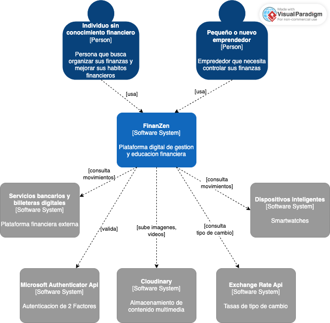
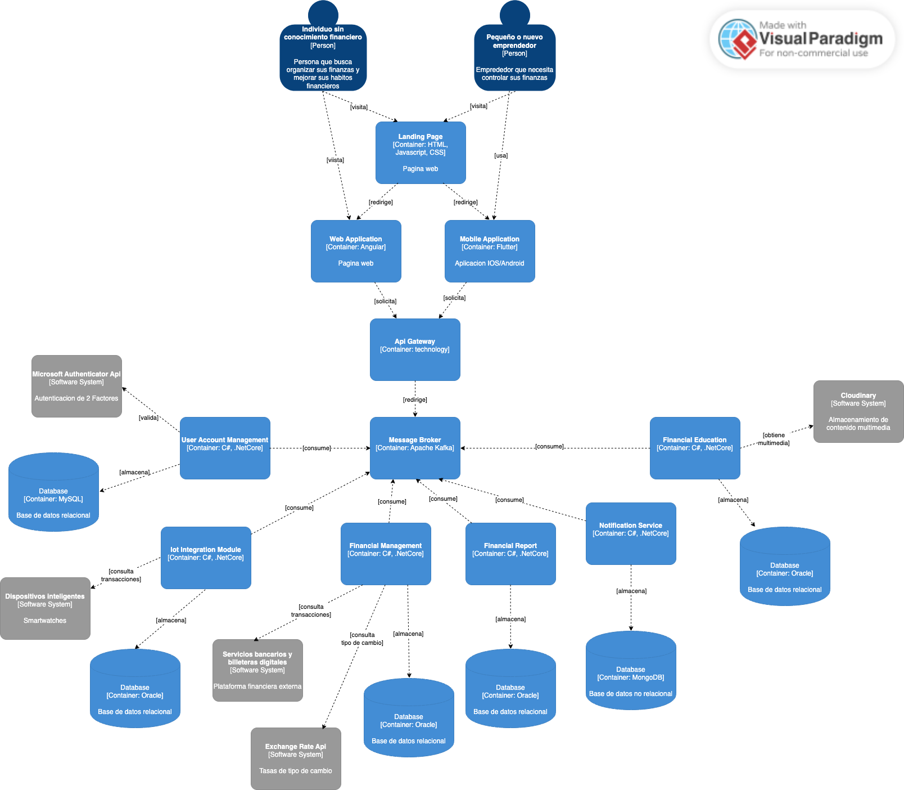
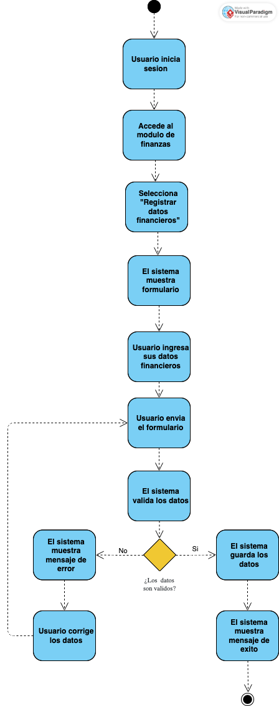
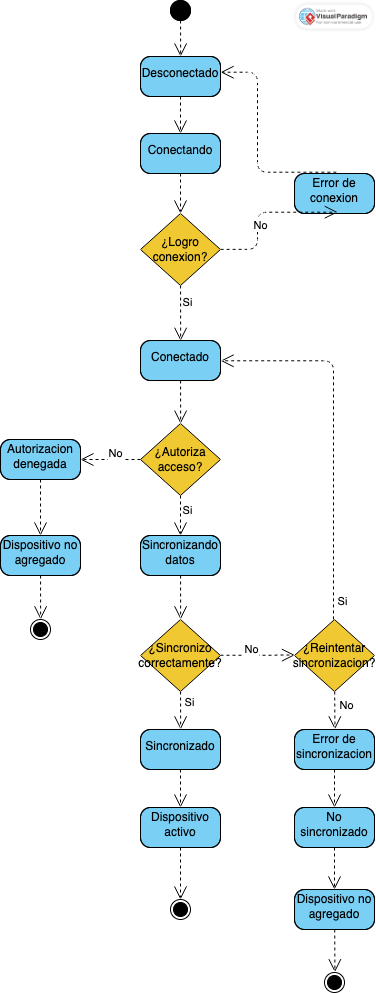
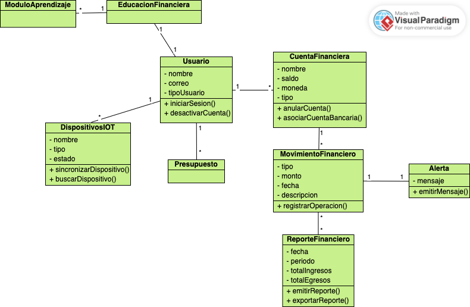
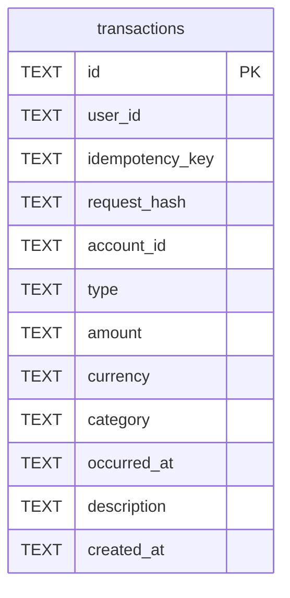
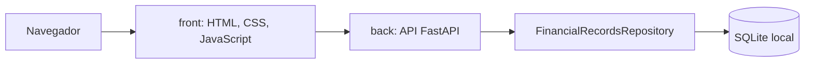

# Capítulo IV: Product Architecture Design

[Volver al informe](../README.md) · Fuente: páginas físicas 59–94 del PDF.

Este capítulo documenta la **arquitectura objetivo**. El incremento disponible
implementa únicamente Financial Records Service y un panel web; el catálogo de
servicios y decisiones siguiente no implica que todos estén desarrollados.

## 4.1. Design Concepts, ViewPoints & ER Diagrams

### 4.1.1. Principles Statements

- Comunicación asíncrona para efectos que no requieren respuesta inmediata.
- Bajo acoplamiento mediante interfaces y contratos explícitos.
- Alta cohesión por capacidad de negocio.
- Security by Design para información personal y financiera.
- Escalabilidad independiente de los servicios con mayor demanda.
- Resiliencia ante fallos parciales y proveedores externos.
- Observabilidad mediante registros, métricas y trazas sin información sensible.

### 4.1.2. Approaches, Architectural Styles & Patterns

El PDF propone DDD para delimitar capacidades y ADD para refinar el diseño por
atributos de calidad. Los estilos seleccionados son microservicios y arquitectura
orientada a eventos. REST atiende operaciones inmediatas; API Gateway centraliza
el enrutamiento y Message Broker desacopla los efectos secundarios.

Apache Kafka aparece como tecnología de mensajería prevista. No hay broker,
publicadores ni consumidores implementados en el backend incorporado.

### 4.1.3. Context Diagram

Se conserva la figura original:

### 4.1.4. Approach Driven ViewPoints Diagrams

Vista de contenedores original:

La figura propone Angular para Web, Flutter para Mobile, servicios C#/.NET,
bases MySQL/Oracle/MongoDB y Kafka. Son tecnologías del diseño, distintas del
primer incremento Python/FastAPI/SQLite y del panel HTML/CSS/JavaScript.
Queda pendiente reconciliar las etiquetas de esa vista con los nombres de
servicios y decisiones ADD de esta versión. No se migró el MVP a esas tecnologías.

Vistas UML originales:

### 4.1.5. Relational/Non Relational Database Diagram

La página física 66 del PDF tiene el título del apartado, pero no muestra un
diagrama de datos. Se conserva una [renderización de esa página](../assets/pagina-066.png).

Como actualización derivada del código, el esquema **actual** de SQLite es:

Existe unicidad conjunta de `user_id` e `idempotency_key`, un índice en
`user_id, occurred_at` y una restricción para tipos `income`/`expense`.
No existen tablas de usuarios, cuentas o categorías: `user_id`, `account_id`
y `category` son valores de la transacción, sin claves foráneas a otros recursos.
El diagrama anterior representa la implementación local, no el modelo completo
de todos los microservicios propuestos.

### 4.1.6. Design Patterns

| Patrón | Uso previsto | Estado actual |
| --- | --- | --- |
| Repository | Abstraer persistencia y consultas del dominio | Implementado en `FinancialRecordsRepository` con SQLite |
| Facade | Simplificar operaciones que coordinan varios subsistemas | Propuesto; no existe coordinación de múltiples servicios |
| Observer / eventos | Reaccionar a movimientos y umbrales sin acoplamiento directo | Propuesto; no existe infraestructura de eventos |

### 4.1.7. Tactics

| Atributo | Tácticas propuestas |
| --- | --- |
| Usabilidad | Componentes consistentes en Web/Mobile y mensajes de estado claros |
| Disponibilidad | Aislamiento de fallos y reintentos para dependencias externas |
| Seguridad | Segundo factor, protección en tránsito/reposo y autorización por recurso |
| Rendimiento | Kafka para efectos asíncronos y escalado de los servicios más exigidos |
| Mantenibilidad | Responsabilidades cohesivas e interfaces Repository |

## 4.2. Architectural Drivers

### 4.2.1. Design Purpose

Definir límites, propietarios de datos y contratos para movimientos financieros,
presupuestos, dispositivos, análisis, educación y notificaciones. La arquitectura
debe distinguir transacciones confirmadas de estimaciones de consumo, explicar
la insuficiencia de datos y permitir registrar movimientos aunque fallen canales
externos de notificación.

### 4.2.2. Primary Functionality

| Driver | Historias | Funcionalidad | Impacto arquitectónico |
| --- | --- | --- | --- |
| PF-01 | US01 | Registrar ingresos, egresos y saldos | Validación monetaria, propiedad, consistencia e idempotencia |
| PF-02 | US10–US12 | Presupuestos, límites y reportes | Agregaciones por periodo/categoría, umbrales y alertas |
| PF-03 | US07–US09 | Dispositivos y consumos | Autorización, adaptadores, normalización, deduplicación y origen |
| PF-04 | US02–US03 | Proyecciones y riesgo de endeudamiento | Análisis separado, suficiencia y explicabilidad |
| PF-05 | US04–US06 | Evaluación y educación personalizada | Perfil educativo, progreso y reglas de recomendación |

### 4.2.3. Quality Attribute Scenarios

Los escenarios del PDF definen objetivos verificables, no resultados de pruebas
de esta entrega.

| ID / atributo | Fuente y estímulo | Ambiente / artefacto | Respuesta | Medida objetivo |
| --- | --- | --- | --- | --- |
| QA-01 Seguridad | Usuario autenticado solicita datos de otra cuenta | Operación normal; API y datos financieros | Rechazar sin revelar datos y registrar intento | 100 % de accesos cruzados rechazados con HTTP 403 |
| QA-02 Rendimiento | Usuario consulta resumen mensual | 50 usuarios concurrentes y hasta 1 000 movimientos por cuenta; Financial Records/Budget | Calcular y devolver totales | p95 ≤ 2 segundos durante diez minutos |
| QA-03 Disponibilidad | Proveedor de notificaciones deja de responder | Servicios financieros operativos; Notification Service | Conservar alertas para reintento sin revertir el movimiento | Ningún movimiento confirmado perdido; 95 % de pendientes entregado dentro de 60 segundos de la recuperación |
| QA-04 Integridad | Dispositivo reenvía una lectura | Reconexión; Device Integration Service | Reconocer identificador y descartar duplicado | Reenviar 100 lecturas mantiene exactamente 100 registros únicos |
| QA-05 Modificabilidad | Equipo incorpora un tipo de dispositivo | Desarrollo/pruebas; adaptadores | Agregar adaptador del contrato común | Sin modificar Budget/Financial Analysis y con pruebas de contrato aprobadas |
| QA-06 Explicabilidad | Usuario solicita proyección sin historial suficiente | Cuenta incompleta; Financial Analysis Service | Explicar insuficiencia sin presentar predicción válida | 100 % de casos bajo el mínimo devuelve `INSUFFICIENT_DATA` y motivo |
| QA-07 Auditabilidad | Actor autorizado modifica límite, dispositivo o dato | Operación normal; servicios de dominio y Audit Log | Registrar actor, acción, recurso, fecha y resultado sin secretos | 100 % de operaciones críticas de la política genera auditoría consultable |

La prueba actual de filtrado por identificador no equivale a QA-01: no autentica
ni verifica HTTP 403 sobre un recurso ajeno. No se ejecutó una prueba de carga
de QA-02 y no existe Audit Log para verificar QA-07.

### 4.2.4. Constraints

| ID | Restricción del documento | Origen |
| --- | --- | --- |
| CON-01 | Arquitectura de microservicios y ADD 3.0 | Curso |
| CON-02 | APIs RESTful documentadas con OpenAPI/Swagger | Curso |
| CON-03 | GitHub, GitFlow, Conventional Commits y versionado semántico | Curso |
| CON-04 | C4 en Structurizr, UML en Lucidchart y datos en Lucidchart/Vertabelo | Curso |
| CON-05 | Despliegue en AWS, Azure o Google Cloud | Curso |
| CON-06 | Documentar contratos y errores sin exponer datos sensibles | Alcance técnico |
| CON-07 | Separar estimaciones de consumo de transacciones confirmadas | Alcance funcional |
| CON-08 | Atender personas naturales y pequeños/nuevos emprendedores | Segmentos objetivo |

Estas restricciones describen el objetivo académico. La organización del código
no acredita por sí sola uso de las herramientas de diagramación ni despliegue
en alguno de los proveedores de nube.

### 4.2.5. Architectural Concerns

| ID | Riesgo o preocupación | Tratamiento previsto | Drivers |
| --- | --- | --- | --- |
| ARC-01 | Acceso de terceros a datos financieros | Identidad, autorización, cifrado y auditoría | QA-01, QA-07, PF-01 |
| ARC-02 | Confundir estimaciones con movimientos confirmados | Tipo, origen, estado y presentación separada | CON-07, PF-03 |
| ARC-03 | Duplicación/pérdida de lecturas al reconectar | Idempotencia, validación y estado de sincronización | QA-04, PF-03 |
| ARC-04 | Proyecciones con datos insuficientes/desactualizados | Umbral, fecha de corte y explicación | QA-06, PF-04 |
| ARC-05 | Proveedor externo afecta el registro | Eventos, reintentos limitados, DLQ y observabilidad | QA-03, PF-02 |
| ARC-06 | Exceso de servicios para la capacidad del equipo | Límites por capacidad y separación justificada | CON-01, PF-01–PF-05 |
| ARC-07 | Divergencia de informe, diagramas, contratos y código | Catálogo, ADR y contratos versionados | CON-02, CON-04 |
| ARC-08 | Educación que no refleja el perfil actual | Versionar evaluación, progreso y reglas | PF-05, QA-06 |

## 4.3. ADD Iterations

El PDF desarrolla cinco iteraciones. A continuación se organizan sus objetivos,
backlogs, conceptos, interfaces, vistas, decisiones y revisión. El desarrollo
completo de cada apartado numerado se conserva en la
[transcripción fuente](../fuentes/transcripcion_pdf.md).

### 4.3.1. Iteration 1: Global System Structure

**Backlog:** ADB1-01 delimitar dominios/servicios (alta), ADB1-02 definir propiedad
y comunicación (alta), ADB1-03 establecer entrada y capacidades transversales
(alta), ADB1-04 uniformar contratos y errores (media).

**Objetivo y drivers:** asignar cada funcionalidad primaria a un servicio con
datos y contratos identificables. PF-01–PF-05, CON-01, CON-02, QA-01, QA-07,
ARC-06 y ARC-07. Se refina FinanZen como sistema completo.

**Conceptos:** microservicios por negocio, API Gateway, Database per Service,
REST para interacciones inmediatas, eventos para efectos secundarios y
observabilidad centralizada. Sus costos incluyen contratos, agregaciones entre
servicios, idempotencia, reintentos y protección de datos en trazas.

| Elemento propuesto | Responsabilidad | Interfaces/eventos |
| --- | --- | --- |
| API Gateway | Enrutamiento, límites y propagación de identidad/trazas | `/api/v1/*` |
| Identity and Access Service | Cuentas, sesiones, roles y consentimientos | `/auth`, `/users`, `/consents` |
| Financial Records Service | Cuentas, categorías y movimientos | `/accounts`, `/transactions`, `TransactionRecorded` |
| Budget Service | Presupuestos, límites y resúmenes | `/budgets`, `/limits`, `/reports` |
| Device Integration Service | Conexiones, lecturas y normalización | `/devices`, `/readings`, `ReadingNormalized` |
| Financial Analysis Service | Proyecciones y riesgo | `/projections`, `/risk-assessments` |
| Financial Education Service | Evaluación, módulos, progreso y recomendaciones | `/assessments`, `/learning-paths`, `/progress` |
| Notification Service | Entrega por canales configurados | `/notification-preferences`, eventos de alerta |
| Audit Service | Auditoría inmutable | Consumo de eventos y consultas autorizadas |

**Vistas y ADR:** C4 de contenedores y UML de componentes con puertos y
adaptadores. ADR-01 capacidades de negocio; ADR-02 propiedad de datos;
ADR-03 REST; ADR-04 eventos; ADR-05 identificador de trazabilidad.

**Revisión:** todas las capacidades tienen responsable; no se consulta la base
de otro servicio. Identidad y auditoría son transversales. Solo Financial Records
se materializa parcialmente en este incremento.

### 4.3.2. Iteration 2: Financial Records, Budgets and Alerts

**Backlog:** ADB2-01 movimientos sin duplicados (alta), ADB2-02 resúmenes por
periodo (alta), ADB2-03 alertas sin bloquear el registro (alta), ADB2-04 consistencia
entre movimientos, presupuestos y reportes (media).

**Objetivo y drivers:** refinar registro → presupuesto → alerta. PF-01, PF-02,
QA-02, QA-03, QA-07 y ARC-05. Se refinan los tres servicios y sus persistencias,
bus de eventos y estados de entrega.

| Concepto | Propósito | Consecuencia |
| --- | --- | --- |
| Idempotency Key | Evitar duplicados ante reintentos | Conservar clave durante una ventana definida |
| Transactional Outbox | Consistencia entre registro y publicación | Publicador y limpieza |
| Consumidor idempotente | Reprocesar eventos con seguridad | Registro de identificadores procesados |
| CQRS limitado | Separar escritura y reportes | Consistencia eventual en resúmenes derivados |
| Retry y DLQ | Aislar fallos de notificaciones | Monitoreo y reprocesamiento controlado |

**Interfaces:** Financial Records valida y registra mediante `POST /transactions`
y consulta mediante `GET /transactions`. Budget consume `TransactionRecorded`,
expone `/budgets` y `/reports` y emite `BudgetThresholdReached`. Notification
consume el umbral y publica `NotificationDelivered` o `NotificationFailed`.

**Vista dinámica:** Cliente → Gateway → Financial Records → Outbox → Bus →
Budget → Notification. UML contempla éxito, duplicado y proveedor caído.
ADR-06 clave idempotente; ADR-07 Outbox; ADR-08 consistencia eventual;
ADR-09 reintentos y DLQ.

**Revisión:** el diseño conserva el movimiento aunque falle la notificación.
El código actual implementa idempotencia y resumen local, sin Outbox, Budget
Service, alertas ni consistencia eventual entre servicios.

### 4.3.3. Iteration 3: Smart Device Integration and Consumption Telemetry

**Backlog:** ADB3-01 autorización/revocación de dispositivos, ADB3-02 normalización,
ADB3-03 deduplicación/orden y ADB3-04 separación de estimaciones; prioridad alta.

**Objetivo y drivers:** recibir, normalizar y publicar lecturas sin transformarlas
automáticamente en transacciones confirmadas. PF-03, QA-01, QA-04, QA-05,
CON-07, ARC-02 y ARC-03. Se refinan registro, adaptadores, normalizador,
almacenamiento de telemetría y publicador.

**Conceptos:** Ports and Adapters, Anti-Corruption Layer, Store and Forward,
Idempotent Consumer y contrato canónico con conversiones versionadas.

**Interfaces:** `POST /devices/connections`, `GET /devices`,
`DELETE /devices/{id}/connection`, `GET /devices/{id}/sync-status`.
La lectura conserva `readingId`, `deviceId`, `ownerId`, `measurementType`,
`value`, `unit`, `occurredAt`, `receivedAt`, `source` y `validationStatus`.
Se publica `ConsumptionReadingNormalized`.

**Vistas y ADR:** componentes Registry, Adapter, Normalizer, Telemetry Store
y Event Publisher; secuencias de conexión, deduplicación y rechazo por revocación.
ADR-10 adaptadores; ADR-11 contrato canónico; ADR-12 `source + readingId`;
ADR-13 separar estimaciones de transacciones.

**Revisión:** nuevos dispositivos no modifican Budget ni Analysis; se ordena por
`occurredAt` conservando `receivedAt`. El catálogo inicial llama al evento
`ReadingNormalized` y el refinamiento `ConsumptionReadingNormalized`; el nombre
canónico debe acordarse antes de implementar. No hay integración IoT actual.

### 4.3.4. Iteration 4: Security and Identity

**Backlog:** ADB4-01 sesiones/credenciales, ADB4-02 propiedad por usuario/recurso,
ADB4-03 consentimiento/revocación, ADB4-04 auditoría sin secretos; prioridad alta.

**Objetivo y drivers:** autenticar, autorizar y auditar operaciones críticas y
revocar sesiones e integraciones. QA-01, QA-07, CON-06, ARC-01 y PF-01–PF-05.
Se refinan Identity, Gateway, políticas de cada servicio, consentimientos,
auditoría y gestión de secretos.

**Conceptos:** OAuth 2.0/OpenID Connect, access tokens breves y refresh tokens
rotados, RBAC más propiedad por recurso, TLS/cifrado en reposo, Audit Log
inmutable y Secrets Manager. Cada servicio verifica identidad y propietario.

**Interfaces:** `/auth/register`, `/auth/login`, `/auth/refresh`, `/auth/logout`,
`/users/me`, `/consents` y revocación de consentimiento. La auditoría incluye
actor, acción, recurso, resultado, fecha y correlación, sin secretos.

**Vistas y ADR:** zonas de confianza y secuencias de login, acceso autorizado,
acceso ajeno y revocación. ADR-14 OAuth/OIDC; ADR-15 tokens breves;
ADR-16 autorización por recurso; ADR-17 cifrado; ADR-18 auditoría minimizada.

**Revisión:** defensa en profundidad, sin confiar solo en Gateway.
`X-User-Id` del MVP es una simulación y no materializa esta iteración.

### 4.3.5. Iteration 5: Predictive Financial Analysis and Personalized Education

**Backlog:** ADB5-01 suficiencia de datos (alta), ADB5-02 versionado del análisis
(alta), ADB5-03 riesgo y alertas explicables (alta), ADB5-04 personalización
educativa (media).

**Objetivo y drivers:** producir resultados comprensibles y reproducibles
con información suficiente. PF-04, PF-05, QA-02, QA-03, QA-06, QA-07,
ARC-04 y ARC-08. Se refinan lectores de datos, políticas de suficiencia,
motor de proyección, riesgo, perfil educativo y recomendaciones.

**Conceptos:** pipeline versionado, reglas de suficiencia previas al cálculo,
resultado explicable, Strategy para métodos de proyección, perfil educativo
separado y eventos de cambio de perfil.

**Interfaces:** `POST /projections`, `GET /projections/{id}`,
`GET /risk-assessments/latest`, `POST /assessments`,
`GET /learning-paths/current` y `GET /recommendations`.
Los resultados conservan periodo, fecha de corte, versión, factores y limitaciones.
Estados: `COMPLETED`, `INSUFFICIENT_DATA` y `FAILED`; los dos últimos incluyen motivo.

**Vistas y ADR:** componentes y secuencias para suficiencia/insuficiencia,
riesgo y actualización educativa. ADR-19 pipeline versionado;
ADR-20 suficiencia previa; ADR-21 resultados explicables; ADR-22 Strategy;
ADR-23 separación del perfil educativo.

**Revisión:** no presentar una predicción sin sustento y conservar trazabilidad
del método. No hay motores de proyección ni educación implementados.

## Diferencia entre arquitectura objetivo e incremento actual

El monorepositorio reúne artefactos, pero no añade por sí mismo Gateway,
mensajería, autenticación o microservicios adicionales. La estructura facilita
incorporar los componentes futuros y mantener trazabilidad con el informe.
