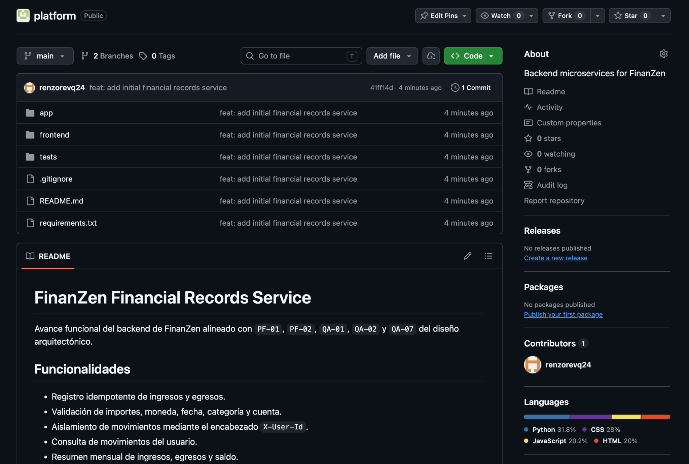
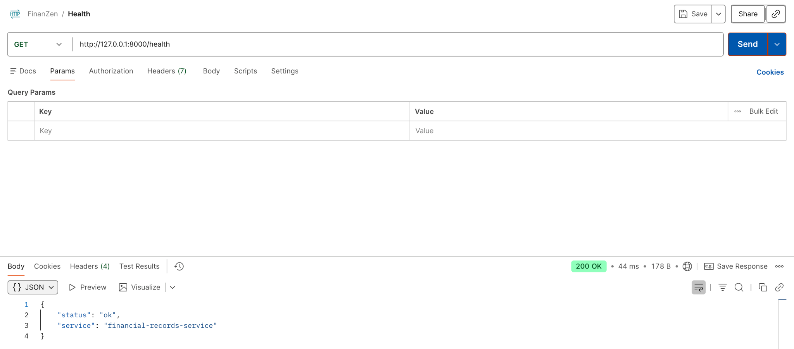
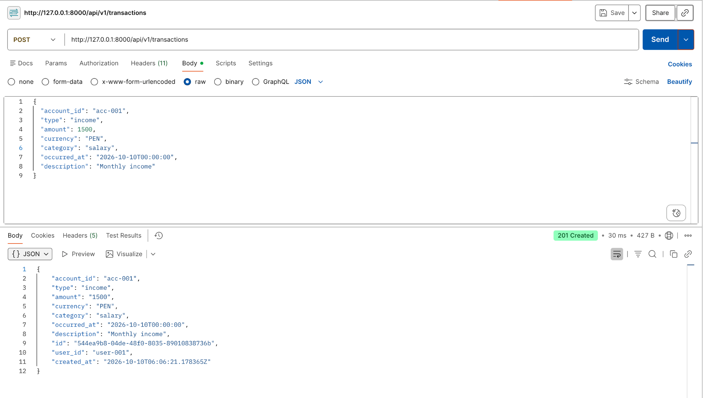

# Capítulo V: Product Implementation, Validation & Deployment

[Volver al informe](../README.md) · Fuente: páginas físicas 95–109 del PDF,
actualizada con el código y la validación de esta entrega.

## 5.1. Testing Suites & General Patterns

### 5.1.1. Backend Application Core Testing Suite

El núcleo utiliza Python, FastAPI, Pydantic y SQLite. Las pruebas de API se
ejecutan con pytest y FastAPI TestClient, sin depender de un servidor externo.
Usan bases temporales para no modificar datos de ejecución.

La suite actual está en [back/tests/test_api.py](../../back/tests/test_api.py):

| Prueba actual | Comportamiento comprobado | Relación con el PDF |
| --- | --- | --- |
| `test_create_is_idempotent_and_rejects_key_reuse` | HTTP 201, repetición HTTP 200 con el mismo ID y conflicto HTTP 409 | Corresponde al comportamiento llamado `test_idempotency_and_conflict` en la fuente |
| `test_summary_calculates_balance_and_isolates_users` | Ingresos, gastos, saldo y filtrado por usuario | Corresponde a `test_summary_balance_and_user_isolation` en la fuente |
| `test_frontend_is_served` | Entrega de una interfaz desde una ruta configurable | Prueba de entrega estática, independiente de incluir el frontend en el paquete del backend |
| `test_backend_runs_without_frontend` | Health/Swagger disponibles sin archivos del cliente | Añadida durante la separación del proyecto |

El PDF describe tres pruebas con los nombres históricos anteriores. Esta
versión documenta los nombres reales y una cuarta prueba. Los resultados y
comandos ejecutados se registran en [validación](../evidencias/validacion.md).

El filtrado por `X-User-Id` comprueba aislamiento lógico para una identidad
indicada por el cliente. No demuestra autenticación ni autorización real.
Tampoco se ejecutan escenarios de carga, telemetría, proyecciones o auditoría.

Para futuros incrementos, el PDF propone separar pruebas unitarias,
integración, persistencia y contratos. Esa estructura sigue siendo una propuesta;
la suite actual conserva un archivo de pruebas de API.

### 5.1.2. Pattern Based Backend Application(s)

Repository está implementado en `FinancialRecordsRepository`. Los contratos
REST se exponen bajo `/api/v1`, y FastAPI genera OpenAPI/Swagger.
La persistencia local usa una única tabla de transacciones.

Microservicios adicionales, Facade entre subsistemas, Observer, Gateway y
Database per Service para múltiples dominios forman parte del diseño objetivo,
sin implementación adicional en esta entrega.

### 5.1.3. Pattern Based Custom Software Library

El PDF propone `finanzen_common`, una librería pequeña de capacidades
transversales. No hay un paquete de ese nombre en el código incorporado.

| Módulo propuesto | Responsabilidad |
| --- | --- |
| `errors` | Modelo común de errores |
| `observability` | Correlation ID y logging estructurado |
| `security` | Identidad propagada y validaciones comunes |
| `events` | Envelope, identificadores y metadatos |
| `idempotency` | Utilidades para claves idempotentes |
| `testing` | Fixtures y factories |

No debe concentrar reglas o entidades de todos los dominios. Su versionado
semántico y distribución deberán definirse cuando se implemente.

### 5.1.4. Framework Pattern Driven Refactoring Report

| Aspecto | Propuesta del PDF | Estado de esta organización |
| --- | --- | --- |
| Controladores | Delegar en casos de uso y mantener routers delgados | Endpoints siguen en `app/main.py`; refactorización pendiente |
| Persistencia | Interfaces de repositorio y adaptador SQLite | Repositorio existente conservado; no se añadió una interfaz abstracta |
| Errores | Excepciones de aplicación y contrato uniforme | Handler de conflicto idempotente existente; normalización completa pendiente |
| Configuración | Variables de entorno y eliminación de rutas dependientes de máquina | `FINANZEN_DB_PATH` y `FINANZEN_FRONTEND_PATH`; frontend vecino `front/` |
| Observabilidad | Correlation ID y logs estructurados | Pendiente |
| Eventos | Publicación para alertas, análisis y auditoría | Pendiente |

La organización adapta la ruta del frontend y conserva la API independiente.
La descripción OpenAPI se corrigió para no afirmar que US10–US12 estén completas.
No se realizó la refactorización arquitectónica completa ni se cambió la
tecnología de persistencia.

## 5.2. Software Configuration Management

### 5.2.1. Software Development Environment Configuration

| Elemento | Versión / uso | Estado |
| --- | --- | --- |
| Python | 3.10 o superior; validación local con 3.11 | Disponible para el backend |
| FastAPI | 0.122.0 | Implementado |
| Pydantic | 2.12.5 | Implementado |
| Uvicorn | 0.38.0 | Servidor local |
| SQLite | Módulo estándar de Python | Persistencia local |
| pytest / httpx | 8.3.5 / 0.28.1 | Pruebas automatizadas |
| HTML, CSS, JavaScript | Panel sin compilación | Implementado |
| Postman | Capturas del PDF | Evidencia histórica; no nueva ejecución de Postman |
| Apache Kafka | Mensajería propuesta | Pendiente |
| Angular / Flutter / C# | Tecnologías del diagrama original | Sin proyecto Angular, Flutter o C# incorporado |

Dependencias fijadas en [requirements.txt](../../back/requirements.txt).
Los pasos de instalación están en [back](../../back/README.md) y
[front](../../front/README.md).

### 5.2.2. Source Code Management

La ubicación actual es
[Darkdren/1ASI0657-2620-9199-FinanSmart](https://github.com/Darkdren/1ASI0657-2620-9199-FinanSmart).
Contiene `back`, `report`, `landing`, `front` y `mobile` en un mismo historial Git.
No se crearon cinco repositorios remotos ni submódulos.

El PDF menciona un repositorio `platform`, ramas `main` y `develop` y el commit
histórico `41ff14d` atribuido a Renzo Revilla. Esa información se conserva como
evidencia del documento, no como un commit importado a este historial.

La estrategia académica propuesta es GitFlow (`main`, `develop`, `feature/*`,
`release/*`, `hotfix/*`), Conventional Commits y SemVer. No se presentan ramas
propuestas como ramas ya creadas. La versión de API existente es `0.1.0`; eso
no constituye una etiqueta de release publicada.

### 5.2.3. Source Code Style Guide & Conventions

Se conservan los nombres del código. El PDF propone PEP 8, PEP 257,
`snake_case` para funciones/módulos, `PascalCase` para clases,
`UPPER_SNAKE_CASE` para constantes, endpoints de recursos en plural y type hints.
También propone errores sin secretos y pruebas de comportamiento.

El workflow [validacion.yml](../../.github/workflows/validacion.yml) instala
dependencias, ejecuta la suite y comprueba la integración y enlaces internos.
No se afirma haber ejecutado linter, formatter o verificación de tipos.

### 5.2.4. Software Deployment Configuration

El apartado aparece vacío en el PDF. En esta entrega se documenta una ejecución
local reproducible, sin inventar un despliegue remoto:

```powershell
cd back
python -m pip install -r requirements.txt
python -m uvicorn app.main:app --host 127.0.0.1 --port 8000
```

Panel en `http://127.0.0.1:8000`, Swagger en `/docs`, OpenAPI en `/openapi.json`
y estado en `/health`. La carpeta `data` y la tabla se inicializan al arrancar.
SQLite, cachés, secretos y entornos virtuales no se versionan.

No hay Dockerfile, infraestructura de nube ni URL pública de despliegue
verificada. CON-05 sigue pendiente.

## 5.3. MicroServices Implementation

### 5.3.1. Sprint 1

#### 5.3.1.1. Sprint Backlog 1

Objetivo registrado en la fuente: permitir crear ingresos/egresos, consultar
movimientos por usuario y obtener un resumen mensual con API documentada y
pruebas. La siguiente tabla conserva estimaciones y responsables del PDF;
no atribuye la organización posterior a esos integrantes.

| ID | Trabajo del PDF | Estimación | Responsable registrado | Estado del PDF |
| --- | --- | --- | --- | --- |
| US01 | Registrar datos financieros | 8 SP | Rodrigo Oblitas | Done |
| TASK-01 | Crear Financial Records Service | 3 h | Renzo Revilla | Done |
| TASK-02 | Modelo de transacción | 2 h | Joan Aguirre | Done |
| TASK-03 | Registrar transacción | 3 h | Renzo Revilla | Done |
| TASK-04 | Consultar transacciones | 2 h | Rodrigo Oblitas | Done |
| TASK-05 | Resumen mensual | 3 h | Joan Aguirre | Done |
| TASK-06 | Idempotencia | 2 h | Renzo Revilla | Done |
| TASK-07 | Aislamiento mediante X-User-Id | 2 h | Rodrigo Oblitas | Done |
| TASK-08 | Persistencia SQLite | 2 h | Joan Aguirre | Done |
| TASK-09 | OpenAPI/Swagger | 1 h | Renzo Revilla | Done |
| TASK-10 | Testing Suite | 3 h | Joan Aguirre | Done |
| TASK-11 | Frontend funcional | 3 h | Rodrigo Oblitas | Done |

La marca Done de US01 corresponde al recorte del sprint en el PDF. Sus
criterios de cuentas/saldos y su equivalencia con el registro de movimientos
requieren revisión; se documentan como cobertura parcial en el capítulo III.

#### 5.3.1.2. Development Evidence for Sprint Review

La evidencia original describe once archivos del servicio inicial y el commit
`41ff14d` de `platform`. Se conserva su captura:



La evidencia actual está en [back/app](../../back/app),
[back/tests](../../back/tests) y [front](../../front). El README del repositorio
ya dirige al informe y a cada componente, en lugar de contener todo el reporte.

#### 5.3.1.3. Testing Suite Evidence for Sprint Review

El PDF registra tres comportamientos con resultado Passed. La suite incorporada
contiene cuatro pruebas y se ejecuta nuevamente para esta entrega. Los resultados
actuales se detallan en [evidencias/validacion.md](../evidencias/validacion.md).

#### 5.3.1.4. Execution Evidence for Sprint Review

Las capturas de Postman del PDF muestran pruebas históricas del servicio local:





| Método | Ruta | Uso |
| --- | --- | --- |
| GET | `/health` | Estado operativo |
| POST | `/api/v1/transactions` | Registrar movimiento |
| GET | `/api/v1/transactions` | Consultar movimientos |
| GET | `/api/v1/summary` | Resumen mensual por moneda y usuario |

La comprobación de esta entrega utiliza TestClient y registra por separado sus
resultados; las capturas originales no se presentan como nuevas ejecuciones.

#### 5.3.1.5. Microservices Documentation Evidence for Sprint Review

FastAPI genera Swagger y OpenAPI a partir de la aplicación. Se conserva un
[contrato OpenAPI de esta entrega](../evidencias/openapi.json), además de la
guía del backend. El contrato describe el servicio disponible, sin endpoints
inventados para capacidades futuras.

#### 5.3.1.6. Software Deployment Evidence for Sprint Review

Pendiente de evidencia de despliegue en AWS, Azure o Google Cloud. El archivo
fuente no aporta URL ni capturas de un entorno cloud. La ejecución verificada
es local y no completa CON-05.

#### 5.3.1.7. Team Collaboration Insights during Sprint

El PDF contiene el título sin desarrollo. Se conserva el backlog y sus
responsables, sin inventar reuniones, revisiones ni conclusiones de colaboración.

#### 5.3.1.8. Kanban Board

El PDF contiene el título sin enlace o tablero verificable. Queda pendiente
incorporar una evidencia real de Kanban.

## Cambios y pendientes de esta entrega

- Cinco carpetas de componentes con documentación y estados explícitos.
- Backend y frontend incorporados desde los proyectos organizados previamente.
- Ruta automática actualizada a `front/`, conservando API sin cliente web.
- PDF, transcripción de las 109 páginas, figuras y README histórico conservados.
- Informe ampliado con entrevistas, 14 historias, drivers y cinco iteraciones ADD.
- Pruebas, contrato OpenAPI, script de comprobación y empaquetado reproducible.
- Landing y mobile reservados sin código, según confirmación del usuario.

Siguen pendientes autenticación, cuentas/saldos, presupuestos, alertas,
eventos, IoT, proyecciones, educación, auditoría y despliegue en nube.
